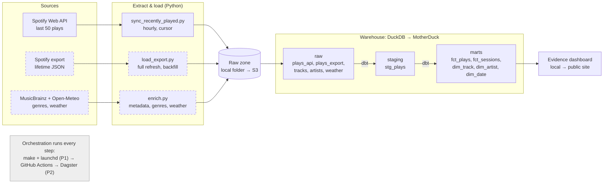

# Backtrack

An ELT pipeline over my Spotify listening history: an hourly API sync, backfilled from the lifetime export → a tested star schema in DuckDB → a dashboard that answers "what was I listening to in June 2022?"

**Why:** I wanted to see exactly what I was playing in any month, years back. Spotify's API only remembers my last 50 plays, and no existing tool gave me that view over data I control. So I'm building it, and using it to learn data engineering properly.

> Status: **Phase 1 (local MVP)** in progress. See the [roadmap](#roadmap).
>
> Phase 1 was re-planned on 2026-11-25 to start from the API instead of the export ([ADR 0004](docs/adr/0004-api-first-mvp.md)). The code in `ingestion/`, `transform/` and the `Makefile` still follows the old export-first plan and is being rebuilt. Until then, the commands below describe the target, not what runs today.

## Architecture



Dashed boxes arrive in phase 2. More detail in [docs/architecture.md](docs/architecture.md).

**Stack:** Python, the Spotify Web API, DuckDB, Parquet, dbt, Evidence, launchd. Phase 2 adds the export backfill, MotherDuck, S3, Terraform, GitHub Actions and Dagster.

**No app database:** plays are append-only history that's only analysed, so they go straight into the warehouse. See [ADR 0001](docs/adr/0001-no-app-database.md).

## Run it

Needs Python 3.11+ and `make`.

```bash
make setup      # virtualenv + dependencies
make fake       # no Spotify app yet? generate fake API responses (kept apart from real data)
make all        # load the raw zone, then build and test every dbt model
make docs       # browse lineage and table docs in your browser
```

To use your real data, create a Spotify developer app and authorise it once ([docs/runbooks/spotify-api-setup.md](docs/runbooks/spotify-api-setup.md)), then run `make sync` to pull your recent plays and `make all` to build. The API only returns the last 50 plays, so history builds up from the first sync; a launchd job runs `make sync all` every hour. `data/` and `.env` are gitignored and nothing personal is committed.

## Roadmap

| Phase | Scope | Done when |
|---|---|---|
| 1. Local MVP | Hourly API sync on my laptop → DuckDB → dbt → local dashboard | `make all` on a fresh clone builds everything from fake data, and my dashboard shows what I played yesterday |
| 2. Backfill, automated + cloud | Lifetime export backfill, S3, MotherDuck, orchestration, public dashboard | The dashboard shows June 2022, and yesterday's plays appear on the public dashboard with no manual steps |
| 3. Photos | Photo metadata joined to plays | Any day shows plays and photos in order |
| 4. Google Timeline | Places and trips joined to plays and photos | The day view shows where I was, what I played and my photos |
| 5. Front end + other people | Timeline UI, accounts, more music services | Someone else can upload their exports and see only their own timeline |

Phase specs live in [docs/phases/](docs/phases/).

## Key decisions

Recorded as ADRs in [docs/adr/](docs/adr/):

- [0001](docs/adr/0001-no-app-database.md): no app database. Plays go straight to the warehouse.
- [0002](docs/adr/0002-duckdb-as-warehouse.md): DuckDB locally, MotherDuck in phase 2.
- [0003](docs/adr/0003-full-refresh-export-loader.md): the export loader does a full refresh, not incremental.
- [0004](docs/adr/0004-api-first-mvp.md): the MVP starts from the API. The export is a phase 2 backfill.

## Repo layout

```
ingestion/     Python loaders and the fake data generator
transform/     dbt project
dashboard/     Evidence site
docs/          architecture, data model, data sources, phases, ADRs, runbooks, retros
tests/         pytest
```

## Privacy

This project processes personal data. Real listening data never leaves my machine or private storage. Spotify credentials live only in `.env`, which is gitignored. The export's IP address field is dropped at load time. Tests, CI and any public demo use generated fake data.
