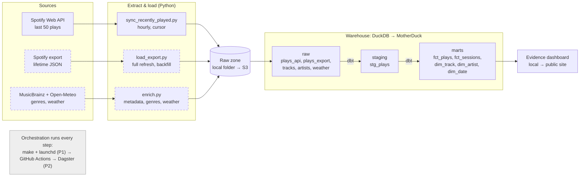

# Architecture

Editable diagram: [architecture.excalidraw](architecture.excalidraw) (open at excalidraw.com, or with the VS Code Excalidraw extension).

## Overview

Dashed boxes arrive in phase 2.

## Flow

1. **Sources.** The Web API only returns the last 50 plays, so it can keep data current but can't backfill. Phase 1 syncs it every hour and builds history from the first sync onward. The extended streaming history export covers the account's lifetime and backfills everything earlier in phase 2. See [data-sources.md](data-sources.md).
2. **Extract and load.** One Python loader per source, all with the same contract: land the extract in the raw zone, write one raw table, safe to re-run, row count and date range printed. The API sync is incremental (it asks only for plays after its cursor). The export loader is a full refresh ([ADR 0003](adr/0003-full-refresh-export-loader.md)).
3. **Raw zone.** A copy of every extract as delivered, partitioned by source and year or date. The one exception is the privacy rule: the export's `ip_addr` is dropped before anything lands. The warehouse can always be rebuilt from it. It's a local `data/raw/` folder in phase 1 and an S3 bucket in phase 2. In phase 1 it's the only copy of plays the API has since forgotten, so `make clean` must never run against real data without a backup.
4. **Warehouse.** DuckDB, with three schemas: `raw` (written by loaders), `staging` and `marts` (written by dbt).
5. **Transform.** dbt models: staging (rename, cast, filter), intermediate (sessions), marts (facts and dimensions).
6. **Serve.** An Evidence dashboard that reads only from `marts`.

## Phase 1 vs phase 2

| | Phase 1 | Phase 2 |
|---|---|---|
| Sources | API | API + export + enrichment |
| History covered | From the first sync | Account lifetime |
| Raw zone | `data/raw/` | S3 (Terraform) |
| Warehouse | `data/listening.duckdb` | MotherDuck |
| Scheduling | launchd on my laptop runs `make sync all` hourly | GitHub Actions, then Dagster |
| Dashboard | Local | Public static site |
