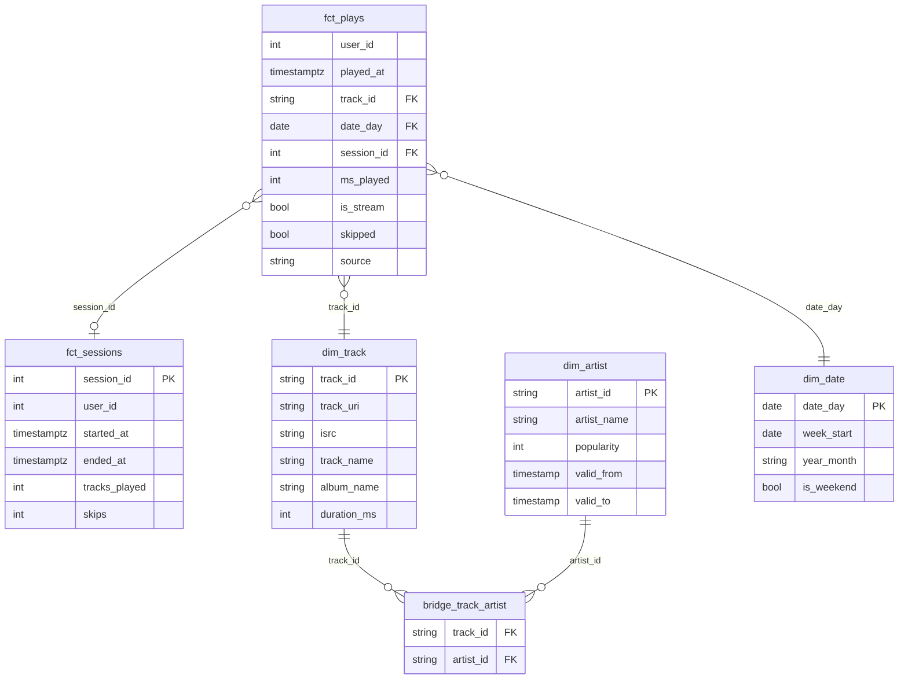

# Data model

Column-level docs live in the dbt `.yml` files. Run `make docs` to browse them with lineage. This page covers the shape and the grain of each table.

## Layers

| Schema | Written by | Purpose |
|---|---|---|
| `raw` | Python loaders | Source data as delivered. Never edited by dbt. |
| `staging` | dbt | One model per source concept. Rename, cast, filter. No joins. |
| `marts` | dbt | Facts and dimensions the dashboard reads. |

## Phase 1 models

| Model | Grain | Status |
|---|---|---|
| `raw.plays_export` | One row per play in the export | Built |
| `stg_plays` | One music play (podcasts excluded) | Built |
| `int_sessions` | One play, with a session number (new session after a 30 min gap) | Week 4 |
| `fct_plays` | One play | Week 4 |
| `fct_sessions` | One listening session | Week 4 |
| `dim_date` | One calendar day | Week 4 |
| `mart_monthly_top` | One track per month, ranked | Week 4 |

## Target star schema (end of phase 2)

A track can have several artists, so artists join through `bridge_track_artist`. Counting plays per artist must go through the bridge carefully to avoid double counting.

## Conventions

- `user_id` on every table, even with one user.
- Timestamps in UTC. `*_nz` columns hold Pacific/Auckland local time.
- Provider IDs (Spotify URI, ISRC) are columns, never table names.
